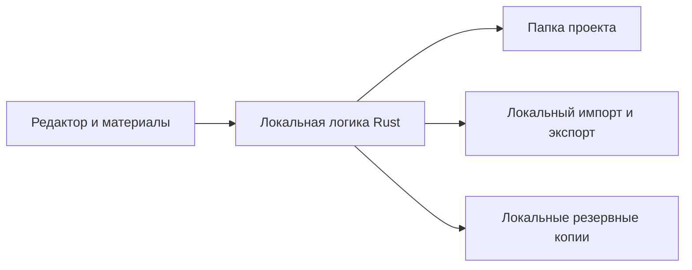

# StoryLens — архитектура приложения

Актуально на **19 октября 2026 года**. Ниже — границы и устройство первой реализации. Продуктовые решения — в [DECISIONS.md](DECISIONS.md), этапы работы — в [PLAN.md](PLAN.md), проверки — в [QA_RESULTS.md](QA_RESULTS.md).

## Границы

- Один автор работает локально на Windows, без аккаунта и модели.
- Логика приложения — Rust. Оболочка — Tauri 2/WebView2, интерфейс — TypeScript без React, редактор — Tiptap 3. SQLite не требуется.
- Интерфейс следует дизайну «Знакомый редактор»: оформление сверху, главы слева, текст в центре, материалы справа по запросу. План сцен и хронология — отдельные представления.
- Серверный слой, онлайн-синхронизация и пользовательский контроль версий исключены.

Запись проекта проходит через контролируемый путь, общий для редактора и операций с материалами. Автору не требуется знать о внутренних редакциях или файловых блокировках.

## Данные

Проект хранит рукопись, заметки, простые карточки персонажей и мира, план сцен, события хронологии и добавленные материалы. Книга или серия с общими материалами не требует отдельного сервера.

- Глава — структурированный JSON с непрерывным текстом и поддерживаемым оформлением.
- DOCX используется при импорте и экспорте; он не становится вторым рабочим источником.
- У сущностей сохраняются устойчивые идентификаторы, чтобы переименование не разрушало связи.
- Материалы и исходники импорта хранятся внутри переносимой папки проекта.
- Порядок сцен в рукописи и время событий — разные сведения.
- Схема версии 1 определена в `src-tauri/src/model.rs`: `schemaVersion`, UUID книги, название, массивы глав, карточек, сцен, событий и вложений. Главы содержат JSON-документы Tiptap; порядок массивов задаёт порядок отображения и экспорта. Сцена может ссылаться на UUID главы. Время события — свободная подпись, порядок задаёт автор.
- Файловая структура: `project.json`, `project.previous.json`, `assets/<UUID>`, `.storylens.lock`. Вложение хранит исходное имя и SHA-256; содержимое файла не меняется приложением после добавления. Отдельный интерфейс томов пока не реализован.

## Редактор и материалы

Представления рукописи, карточек, плана и хронологии используют одни данные проекта. Переключение представления не создаёт независимых копий текста. Простая карточка допускает свободное описание и не требует заполнения анкеты.

Объём комментариев и привязок к выделению ещё согласуется. Если такие записи включаются, они должны выдерживать обычные правки, перенос и отмену. После удаления фрагмента заметка не должна исчезать или автоматически прикрепляться к неверному месту.

Служебная подсветка отделена от оформления рукописи. Проверки и будущая модель не меняют авторский текст автоматически.

## Импорт и экспорт

Все операции выполняются локально: импорт DOCX, экспорт DOCX, Markdown, TXT, PDF, EPUB. Исходный DOCX сохраняется; потери и неподдерживаемые элементы явно сообщаются автору.

Публичный ZIP не содержит EXE конвертеров. Однократный явный запуск `Prepare-converters.cmd` получает Pandoc 3.12.1 и Typst 0.15.1 из официальных выпусков с проверкой SHA-256 и чистой распаковкой. После подготовки они находятся в `tools` рядом с приложением; обычный запуск ничего не загружает. Release-сборка не ищет инструменты в исходной папке разработчика; fallback оставлен только для debug. Такой состав позволяет не распространять GPL-бинарник с неполным комплектом соответствующих исходников.

Pandoc запускается с `--sandbox`, Typst — с корнем временной папки. Rust строит HTML из разрешённых узлов и экранированного текста; URL и исполняемые вставки в этот HTML не попадают. PDF использует системный Times New Roman. Исходники, лицензии и границы поставки — в [THIRD_PARTY.md](THIRD_PARTY.md).

Перед DOCX-конвертацией проверяются все записи ZIP, объявленные и фактически прочитанные размеры, CRC, лимиты 4096 записей / 64 МБ на запись / 128 МБ суммарно. Захват stdout/stderr идёт во временные файлы с проверкой размера каждые 20 мс, чтение ограничено 64 МБ / 1 МБ; процесс ограничен 120 секундами. При превышении, ошибке ожидания или чтения процесс завершается и ожидается его выход. Это не жёсткая квота памяти или диска для чужого процесса. Временные файлы и каталог экспорта содержат текст и удаляются при штатном завершении операции; аварийное завершение может оставить их на диске.

Импортированный HTML разбирается редактором с ограниченной схемой; таблицы разворачиваются в абзацы, изображения заменяются подписью. Отчёт импорта показывает общий предел точности и обнаруженные сложные элементы Word. Макет страниц Word не переносится; точность на произвольных реальных документах пока не подтверждена.

## Сохранность

- Автосохранение текущей работы отделено от ручного экспорта.
- При обрыве записи последнее исправное состояние остаётся доступным; незавершённые файлы не считаются сохранённой работой.
- Параллельные попытки записи не должны молча перезаписывать изменения. Несколько редактирующих окон не являются автоматически утверждённой функцией.
- Резервная копия создаётся из согласованного состояния и содержит данные для восстановления рукописи и материалов.
- Восстановление проверяет содержимое и пути. Существующая папка не перезаписывается молча.
- Ошибки записи, восстановления и конвертации видны пользователю; секреты и текст рукописи не включаются в обычную диагностику.

Пользовательские ветки, слияния и просмотр истории не нужны для этих свойств. Конкретный механизм хранения определяется проверками отказов и восстановления.

## Выбор технологий

- Начать с согласованных сценариев редактора и локальной сохранности.
- Использовать возможности платформы и подходящие библиотеки, не добавляя зависимость без задачи.
- Проверить кандидатов на Windows, кириллицу, работу без сети и поставку пользователю.
- Не переносить результаты удалённого прототипа на новую реализацию; повторить необходимые проверки.

## Реализованный путь записи

`src/save-queue.js` сериализует сохранения и повторно снимает снимок после правок во время записи. Rust валидирует схему и ссылки, проверяет вложения и сравнивает текущий JSON с ранее прочитанными байтами. Файловая блокировка стандартной библиотеки удерживается до закрытия книги или завершения процесса.

Запись создаёт уникальный временный файл в той же папке, вызывает `sync_all` и заменяет назначение через Windows `MoveFileExW(REPLACE_EXISTING | WRITE_THROUGH)`. Перед этим отдельной атомарной записью обновляется `project.previous.json`. Незавершённые временные файлы при открытии не читаются. Проверка обрыва перед заменой есть в тестах; реальное отключение питания и гарантии аппаратного накопителя не проверены.

Полный ZIP содержит согласованный `project.json` и все перечисленные вложения. При восстановлении проверяются имена, дубликаты, лимиты распаковки, символьные ссылки, схема и SHA-256. Сначала создаётся временная папка, затем она переносится под новым именем; существующая папка не заменяется. Автоматические копии лежат в соседней `StoryLens backups/<UUID>/`, создаются при первой записи и при дальнейших записях с интервалом от пяти минут. Автоочистки нет. Ручная копия использует актуальный снимок из редактора даже при конфликте обычного сохранения.

Журналирование рукописи отсутствует. Ошибки файловых операций возвращают тип ошибки, не содержимое. CSP запрещает сетевые подключения интерфейса за пределами IPC. Локальные файлы выбираются нативными диалогами; фронтенд не получает универсального API чтения или записи произвольных путей.

Сложные базы канона, графы, дополнительные окна, шифрование, облачные копии и плагины не проектируются заранее: сначала согласуется необходимость функции в [DECISIONS.md](DECISIONS.md).
