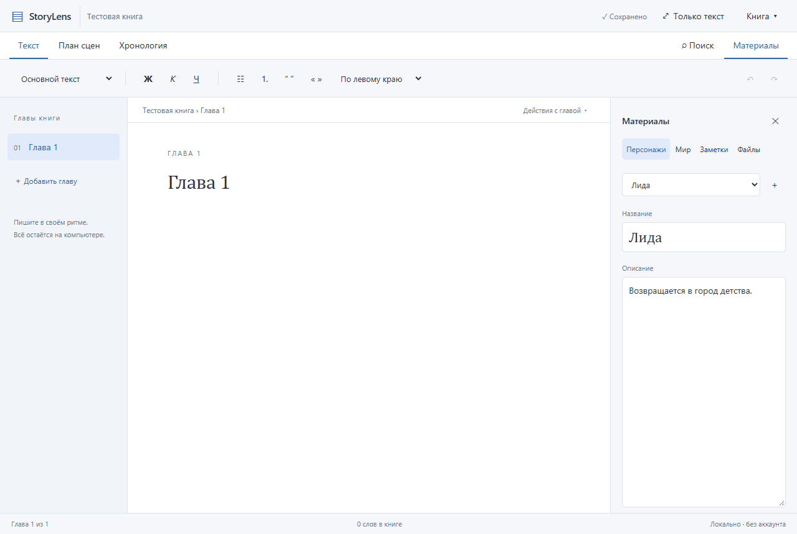

# StoryLens

[Русский](README.md) · [Windows downloads](https://github.com/AzhgulovRasul/StoryLens/releases) · [Test results (Russian)](QA_RESULTS.md)

A local manuscript editor for Windows. Write continuous chapters with familiar formatting, keep character/world cards and notes nearby, arrange scenes and maintain a simple timeline. The current interface is **Russian**. No account, online sync, collaboration or AI model is included.

**0.1.0 is the first preview release.** Core workflows have been tested on the development computer. Clean-machine installation and extended use with real manuscripts remain unverified.



## Run

1. Download `StoryLens-0.1.0-windows-x64.zip` from Releases and extract the entire folder to a writable location. Node.js and Rust are not needed by end users.
2. Run `StoryLens.exe`. Writing, materials, saving and project backups work offline immediately.
3. For document import/export, run **`Prepare-converters.cmd`** once with internet access. The readable `scripts/get-tools.ps1` downloads Pandoc 3.12.1 and Typst 0.15.1 directly from their official GitHub releases, verifies pinned SHA-256 hashes and places them in `tools`. It does not upload manuscripts or need administrator privileges.
4. Import/export then work offline. Move the entire application folder, including `tools`, when transferring the app.

Converter executables are **not redistributed in the public StoryLens ZIP**. Users obtain them directly from upstream. The archive includes the StoryLens MIT license and dependency notices. `SHA256SUMS.txt` is provided beside the download; a checksum is not a digital signature.

Requires Windows 10/11 x64 and Microsoft Edge WebView2 Runtime. The executable is unsigned. Missing-Runtime installation, SmartScreen behavior and a clean Windows machine have not been tested.

## Writing and storage

Create a book by choosing a parent folder; StoryLens creates a new book folder inside it. Open an existing book by selecting the folder containing `project.json`. Chapters appear on the left, formatting above the text, optional materials on the right. Scene planning, timeline and text-only mode have their own controls.

`Ctrl+S`: save now; `Ctrl+Z` / `Ctrl+Y`: undo/redo text; `Ctrl+F`: search chapters, cards, scenes and events. `Esc` closes search or text-only mode. File contents are not indexed. Deleting a chapter/card/scene/event requires confirmation and is not covered by text undo.

The working source is structured **JSON**, with attachments copied into `assets/<UUID>`. Move the whole book folder after closing it. There is no automatic Word-file synchronization.

Autosave serializes writes, keeps the previous valid JSON, rejects external file changes and locks a book against another editing session. A complete ZIP backup is made on the first save and subsequent saves at intervals of at least five minutes. Automatic backups sit next to the project under `StoryLens backups/<UUID>`, on the **same disk**, without automatic retention cleanup. Use a manual backup on another drive to protect against disk failure. Restore creates a new folder and checks paths, schema and attachment hashes.

Project files and backups are **plaintext**, without encryption. The app has no manuscript telemetry, service conversion or account login. Initial tool preparation uses the network; normal editing and conversion use local files and processes.

## Import and export

DOCX import adds a **new chapter**, preserves the source in Materials and reports conversion limitations. Text, headings up to level 3, lists, quotations, bold, italic, underline and strike-through are supported. Word page layout/styles, editable tables, images, comments and editable footnotes are not preserved. Tables become text; images become placeholders. Compare imported content with the original.

Export the whole manuscript in chapter order to **DOCX, PDF, EPUB, Markdown or TXT**. Cards and attachments belong to project backups, not manuscript exports. TXT drops formatting; Markdown drops some formatting/alignment. PDF uses the installed Times New Roman font. Exact Word layout or editor-to-export visual equivalence is not promised. Inspect the output in its intended reader.

Limits: 64 MiB working JSON, 10,000 chapters, 250 MiB per attachment and 1 GiB total attachments. Imported DOCX: 100 MiB compressed, 4,096 entries, 64 MiB per expanded entry and 128 MiB total. Converters have a two-minute deadline, 64 MiB captured stdout and 1 MiB stderr limits. Oversized/failed conversion does not replace an export target.

## Develop

Windows prerequisites: Node.js 22+, Rust 1.89+, MSVC C++ Build Tools and WebView2 Runtime. Internet is needed to obtain dependencies and conversion tools.

```powershell
git clone https://github.com/AzhgulovRasul/StoryLens.git
Set-Location StoryLens
npm.cmd ci
./scripts/get-tools.ps1
npm.cmd run tauri -- dev
```

Checks: `npm.cmd test`, `npm.cmd run test:ui` (Edge required), `cargo test --manifest-path src-tauri/Cargo.toml --locked`, and `cargo clippy --manifest-path src-tauri/Cargo.toml --all-targets --locked -- -D warnings`.

Package: `./scripts/package.ps1`. It collects notices from installed dependencies, builds the optimized Windows executable and creates the portable ZIP and SHA-256 file. Converters are not copied into that public ZIP.

Stack: Rust, Tauri 2, TypeScript and Tiptap 3; no React or SQLite. See [architecture](ARCHITECTURE.md), [decisions](DECISIONS.md), [plan](PLAN.md) and [third-party components](THIRD_PARTY.md). StoryLens source is [MIT licensed](LICENSE); dependency licenses remain their own.
